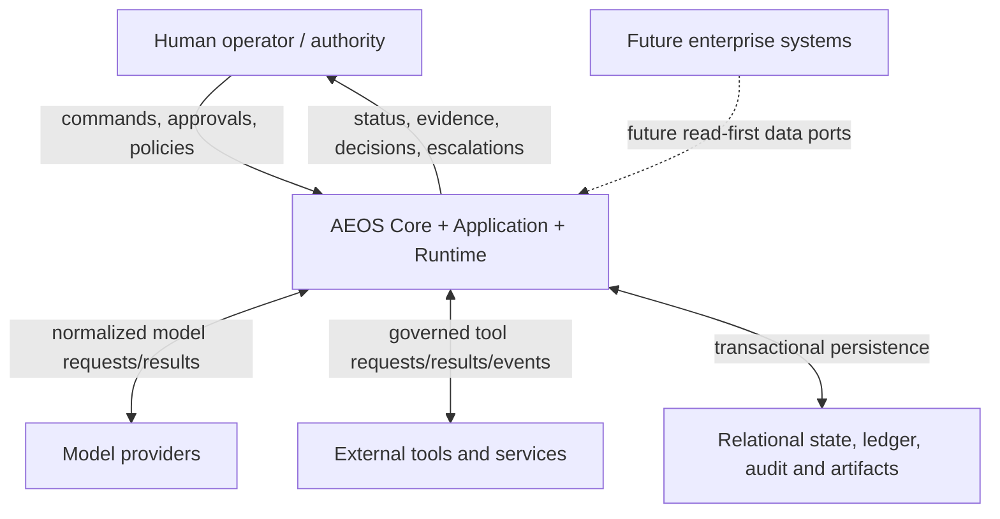
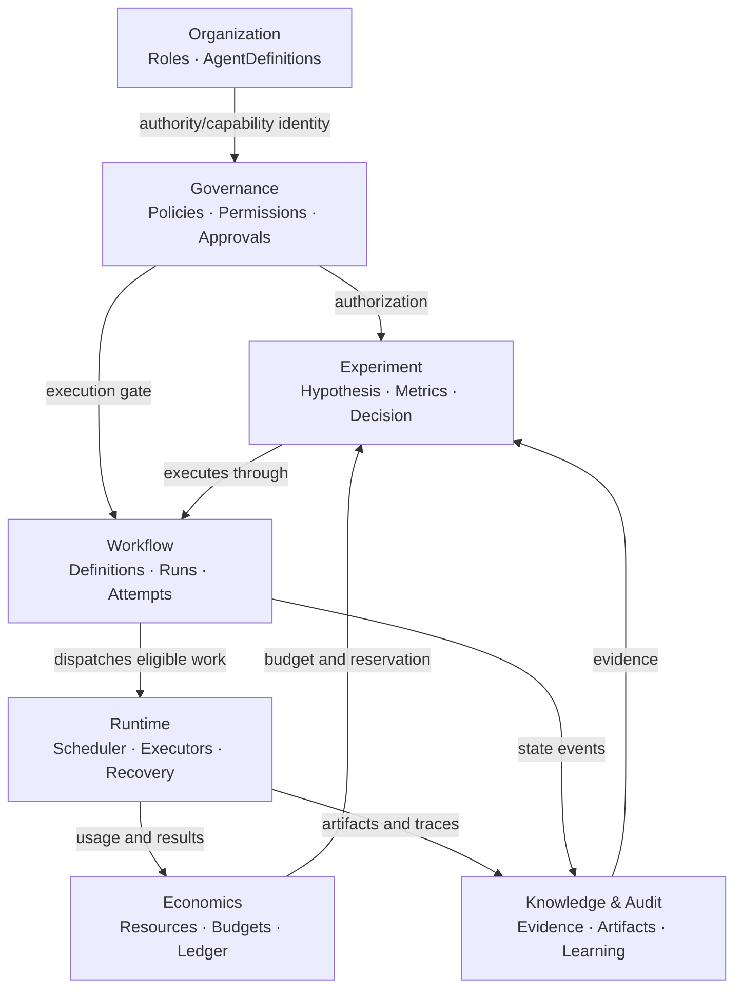

# AEOS Minimum Viable Technical Architecture

**Working Technical Architecture v0.1**  
**Status:** provisional architecture baseline  
**Scope:** AEOS Core; no production code in this deliverable  
**Inputs:** conceptual decisions from Chats 02–07 and the technical constraints established in Chat 08

---

## Executive decision

AEOS v0.1 will be a **modular monolith with relational persistence, explicit state machines, a balanced append-only resource ledger, an append-only audit trail, ports and adapters, and a small recoverable runtime**.

The core architectural sequence is:

```text
Domain → contracts → invariants → state → events → boundaries → adapters → technology
```

The system will not begin as a collection of agents. It will begin as a durable organizational and economic kernel able to answer, for every material operation:

> What happened, why, under whose authority, from which prior state, using which versions, at what cost, with what evidence, and whether it can be reproduced?

The first executable proof must work **without a real LLM**. Fake executors must demonstrate authorization, reservation, workflow execution, cost settlement, evidence, waiting, restart, resume, decision and learning.

### Non-negotiable principles

1. **Build an organization, not a swarm.**
2. **Survival never overrides the Constitution.**
3. **LLMs propose; deterministic AEOS logic validates, authorizes, accounts and transitions state.**
4. **Agents are organizational capabilities, not personalities or long prompts.**
5. **Agents for judgment; code for plumbing.**
6. **Workflow definition is not workflow execution.**
7. **Experiment is not workflow.** An experiment may own several workflow runs.
8. **Reservation precedes consumption.** No authorized resource, no execution.
9. **External content is untrusted data, never authority.**
10. **Current state is relational; material history is append-only.** Full event sourcing is not an MVP requirement.
11. **Waiting consumes no reasoning loop.** A waiting process may terminate completely.
12. **Exactly-once execution across external systems is not assumed.** Idempotency and reconciliation are explicit.
13. **Organizational knowledge survives agent instances.**
14. **Simulation and real execution use the same domain rules.** Only adapters and clocks differ.
15. **The Enterprise Decision Engine remains a future layer above AEOS Core.**

---

# I. Minimum architecture definition

## 1. Minimum bounded modules

The MVP contains seven domain/runtime modules. These are logical boundaries inside one deployable application, not microservices.

| Module | Owns | Does not own |
|---|---|---|
| **Organization** | organizations, roles, responsibilities, authority assignments, agent definitions and lifecycle | approval decisions, spending balances, workflow execution |
| **Governance** | constitution versions, policies, permissions, approval requirements, approval decisions, overrides | resource availability, provider calls, business workflow state |
| **Economics** | resources, accounts, budgets, reservations, commitments, consumption, pricing and ledger | deciding organizational authority, executing tools |
| **Experiments** | objective, hypothesis, preregistration, metrics, stop/success criteria, evidence evaluation, outcome, decision and learning | node scheduling, provider mechanics |
| **Workflows** | workflow definitions, graph semantics, dependencies, workflow runs, node runs, attempts, waits and transitions | model selection implementation, accounting authority |
| **Runtime** | scheduling READY work, executor dispatch, leases, retry mechanics, recovery and adapter invocation | changing domain rules, granting permissions, calculating authoritative cost |
| **Knowledge & Audit** | artifacts, evidence, provenance, decisions, learnings, audit events and reproducibility manifests | becoming an ungoverned memory dump or replacing source systems |

Two cross-cutting layers are not bounded domains:

- **Application:** coordinates use cases and transaction boundaries across modules.
- **Infrastructure:** implements persistence, provider, tool, clock, file, scheduler, logging and secret adapters.

`Core` or `Shared Kernel` should remain very small: IDs, time types, resource quantities, money, version references, actor/cause references, errors and domain-event contracts.

## 2. Core-domain entities

### Organization

| Aggregate/entity | Purpose |
|---|---|
| `Organization` | Root identity, status and current constitutional reference |
| `Role` | Responsibility and authority position; not an executable agent |
| `RoleAssignment` | Assigns an actor or agent definition to a role within scope and time |
| `AgentDefinition` | Versioned capability and contract blueprint |
| `AgentInvocation` | Durable record of one activation of an agent definition for a node attempt |

### Governance

| Aggregate/entity | Purpose |
|---|---|
| `ConstitutionVersion` | Immutable fundamental constraints |
| `PolicyVersion` | Immutable executable policy rules and scope |
| `PermissionGrant` | Actor/capability/action/resource authorization |
| `ApprovalRequest` | Request awaiting a competent authority |
| `ApprovalDecision` | Immutable allow, deny, expire or revoke decision |
| `GovernanceDecision` | Normalized `ALLOW`, `DENY` or `REQUIRE_APPROVAL` result with reasons |

### Economics

| Aggregate/entity | Purpose |
|---|---|
| `Resource` | Cash, credits, tokens, compute, tool capacity, human time or another typed unit |
| `ResourceAccount` | Available, reserved, committed, consumed or external/contra account |
| `Budget` | Purpose-bound authorization over one or more resources |
| `BudgetLimit` | Limit by resource, period, scope and optional owner |
| `Reservation` | Hold created before execution |
| `EconomicTransaction` | Immutable journal header describing one economic fact |
| `LedgerPosting` | Immutable balanced movement between accounts |
| `UsageReport` | Raw provider/tool/compute usage; not yet authoritative monetary cost |
| `PricingVersion` | Immutable conversion rule from usage to cost |
| `CostAllocation` | Attribution of settled cost to node, workflow, experiment and agent invocation |

### Experiments

| Aggregate/entity | Purpose |
|---|---|
| `Objective` | Desired organizational outcome |
| `Experiment` | Governed unit of hypothesis-driven learning |
| `Hypothesis` | Testable proposition and expected mechanism |
| `MetricDefinition` | Primary, secondary or guardrail measure |
| `ExperimentCriterion` | Success, failure, inconclusive, stop or scale criterion |
| `Observation` | Measured value with time and provenance |
| `ExperimentAssessment` | Interpretation of accumulated evidence |
| `Decision` | Continue, stop, pivot, scale, reject or request more evidence |
| `Learning` | Reusable conclusion with scope, confidence and evidence references |

### Workflows and runtime

| Aggregate/entity | Purpose |
|---|---|
| `WorkflowDefinition` | Immutable versioned graph and contracts |
| `NodeDefinition` | Typed work definition: agent, code, tool, validator, policy, router, approval, wait or synthesis |
| `EdgeDefinition` | Dependency, data, conditional, error or escalation relationship |
| `WorkflowRun` | Execution of one frozen workflow version |
| `NodeRun` | Logical execution state of one node in a workflow run |
| `NodeAttempt` | One numbered attempt with a stable execution identity |
| `WaitCondition` | Durable resume predicate, deadline and correlation key |
| `ExecutionLease` | Time-bounded claim preventing concurrent workers from running the same attempt |
| `ExternalAction` | Planned and observed external side effect with idempotency/reconciliation data |

### Knowledge, evidence and audit

| Aggregate/entity | Purpose |
|---|---|
| `Artifact` | Immutable or versioned payload reference plus content hash |
| `Evidence` | Claim-supporting item with source, classification and transformation lineage |
| `ProvenanceLink` | Directed relationship between source, transform, output and producer |
| `AuditEvent` | Append-only record of a material state/authority action |
| `ReproducibilityManifest` | Frozen versions, configuration hashes, inputs and environment references for a run |

The MVP should not create `Venture`, enterprise customer/product entities, a graph database model or a permanent conversational memory aggregate yet.

## 3. Logic completely independent of LLM providers

The following logic must be deterministic and provider-free:

- identity and version resolution;
- role and permission evaluation;
- policy and approval gates;
- budget availability, reservation, release, commitment and settlement;
- ledger balancing and cost allocation;
- state-machine transitions;
- dependency satisfaction and node readiness;
- deadline, loop, retry and stop-condition enforcement;
- schema validation and contract checking;
- idempotency-key generation and duplicate detection;
- execution leasing and recovery classification;
- artifact hashing and provenance linking;
- metric calculations, aggregations and deterministic comparisons;
- audit-event emission rules;
- experiment preregistration and outcome-state validity;
- simulation clock and scenario determinism.

An LLM may recommend an action, classify ambiguous material, synthesize evidence or generate a hypothesis. It may not directly declare that money exists, authorize itself, mutate workflow state, mark its own output valid, settle its own cost or erase its history.

The enforced sequence is:

```text
LLM proposes
→ contract validation
→ Governance authorizes
→ Economics reserves
→ Runtime executes
→ validators evaluate
→ Economics settles
→ AEOS records state, evidence and audit
```

## 4. Application Layer

Application owns use-case coordination, not business rules or provider details.

### Commands

- create organization and install constitution;
- register/version role, policy, agent and workflow definitions;
- create/propose/authorize/start/stop/complete an experiment;
- allocate/close a budget;
- instantiate and advance a workflow run;
- request and decide approval;
- reserve/release/settle a resource;
- record evidence, decision and learning;
- receive an external event and resume eligible work;
- recover unfinished executions;
- reconcile an uncertain external action.

### Queries

- current organization/economic/experiment/workflow state;
- available, reserved, committed and consumed resources;
- ready/waiting/failed work;
- audit and causal trace;
- cost by node, workflow, experiment, agent definition or capability;
- evidence and provenance chain;
- reproducibility manifest and comparison dataset.

### Application responsibilities

- open the transaction boundary;
- load aggregates through repositories;
- call domain methods in the correct order;
- coordinate Governance → Economics → Workflows/Runtime;
- persist state and append records atomically where they share one database;
- publish internal domain events through an in-process dispatcher after commit;
- return DTOs/errors to CLI or API.

Application must not contain SQL, provider SDK calls, prompt text, pricing arithmetic duplicated from Economics or policy rules copied from Governance.

## 5. Infrastructure

Infrastructure implements ports defined inward of it:

- relational repositories and unit of work;
- database migrations;
- model-provider adapters;
- tool adapters and connector credentials;
- local/object artifact storage;
- real clock and simulation clock;
- scheduler/poller and execution worker;
- transactional outbox delivery;
- structured logging and metrics export;
- configuration and secret loading;
- CLI/API transport;
- external-event ingestion;
- backup/restore and database health.

Infrastructure may normalize provider errors and usage, but may not decide the authoritative economic charge, permission or workflow transition.

## 6. Data persisted from the MVP

Persist from day one:

1. Organization, roles and assignments.
2. Every immutable version of constitution, policy, agent definition, prompt, workflow and pricing used by a run.
3. Resources, accounts, budgets and limits.
4. Reservations, economic transactions, postings, usage and cost allocations.
5. Experiments, preregistration, metrics, criteria, status, outcome, decisions and learnings.
6. Workflow definitions, nodes, edges, workflow runs, node runs and attempts.
7. Wait conditions, approval requests/decisions and deadlines.
8. Agent invocations, model calls and tool calls.
9. External-action intents, idempotency keys, provider references and reconciliation status.
10. Artifacts, hashes, evidence and provenance links.
11. Audit events, errors and actor/cause references.
12. Reproducibility manifests and simulation scenario/seed.
13. Outbox messages and durable external-event inbox entries.

Large payloads may live outside the relational database, but their metadata, content hash, media type, storage reference, producer and access classification must be relationally recorded.

## 7. Data that may remain temporary

The following may be process-local or short-lived if no material decision depends on it:

- instantiated provider SDK clients and database sessions;
- compiled prompt strings, if the component versions and exact final request artifact are persisted for material calls;
- streaming token fragments before a completed response;
- executor objects, locks and thread/task handles;
- derived dashboards and read caches;
- scheduler polling cursors recoverable from durable state;
- transient search ranking candidates not admitted as evidence;
- temporary files that are either discarded or promoted to hashed artifacts;
- ephemeral agent working memory inside one attempt.

Nothing required to authorize, charge, resume, reconcile, explain or reproduce a material action may remain only in RAM.

## 8. Append-only audit requirements

| Record | Append-only rule |
|---|---|
| `LedgerPosting` | Never update/delete; correct through a reversing/adjusting transaction |
| `AuditEvent` | Never rewrite; append correction or supersession event |
| `ApprovalDecision` | Decision is immutable; revocation is a later decision |
| `ModelCallRecord` | Request/result metadata, usage and provider identity immutable after finalization; late usage correction is appended |
| `ToolCallRecord` / `ExternalAction` | Intent and observations retained; reconciliation adds facts |
| `ExperimentDecision` | Original decision retained; later review links a new decision |
| `EvidenceAdmission` | Admission/classification history retained; withdrawal does not erase source |
| `VersionPublication` | Published definitions are immutable; changes create a new version |
| `DomainEvent` | Material transitions retain actor, cause, before/after and correlation IDs |

Mutable current-state tables remain permitted for efficient queries. Their material transitions must be paired with immutable history in the same transaction.

## 9. Economic ledger model

The economic source of truth is a **balanced multi-resource journal**, not mutable `budget.spent` fields.

### Accounts

Each resource/unit has accounts such as:

```text
AVAILABLE
RESERVED
COMMITTED
CONSUMED
EXTERNAL_SOURCE_OR_SINK
```

`Cash USD`, `OpenAI credits USD-equivalent`, `input tokens`, `human minutes` and `compute seconds` are distinct resources. They are never silently added together. Valuation is a separate, versioned view.

### Transaction structure

```yaml
economic_transaction:
  transaction_id:
  type: OPENING | ALLOCATE | RESERVE | RELEASE | COMMIT | CONSUME | CREDIT | REFUND | ADJUST
  occurred_at:
  effective_at:
  actor_ref:
  authorization_ref:
  cause_ref:
  pricing_version_ref:
  idempotency_key:
  postings:
    - resource_id:
      account_id:
      quantity:
      unit:
```

For every resource in a transaction, signed postings sum to zero. A correction is a new transaction.

### Example

| Event | Available | Reserved | Consumed |
|---|---:|---:|---:|
| Opening experiment budget | +5.00 | 0.00 | 0.00 |
| Reserve node maximum | -1.00 | +1.00 | 0.00 |
| Settle actual cost | 0.00 | -0.63 | +0.63 |
| Release unused reserve | +0.37 | -0.37 | 0.00 |
| Ending position | 4.37 | 0.00 | 0.63 |

### Invariants

- available and reserved cannot become negative unless an explicitly different account policy allows it;
- a reservation cannot exceed its budget and organization resource availability;
- one usage item is settled once;
- every consumption references usage or a documented adjustment;
- currency/units do not mix within a balanced posting group;
- pricing converts usage to monetary cost but does not erase raw usage;
- Economics alone posts authoritative movements.

## 10. Workflow state model

### Three separate levels

```text
WorkflowDefinition (immutable version)
  └─ NodeDefinition + EdgeDefinition

WorkflowRun (one execution of one frozen version)
  └─ NodeRun (logical node state)
       └─ NodeAttempt 1..n (physical attempts)
```

### WorkflowRun states

| State | Meaning |
|---|---|
| `CREATED` | Instantiated but not yet evaluated for readiness |
| `READY` | Start conditions satisfied |
| `RUNNING` | At least one node is active or advancement is in progress |
| `WAITING` | No runnable node until a durable condition/event/deadline/approval is satisfied |
| `PAUSED` | Explicit administrative hold |
| `COMPLETED` | Terminal success criteria met |
| `FAILED` | Terminal execution failure according to workflow policy |
| `CANCELLED` | Intentionally terminated by authorized action |

`BLOCKED` should be a queryable reason, not necessarily another top-level state: a run may be `WAITING` with `wait_reason=BUDGET`, `APPROVAL`, `DEPENDENCY`, `EVENT` or `RECONCILIATION`.

### NodeRun states

| State | Meaning |
|---|---|
| `PENDING` | Dependencies not yet satisfied |
| `READY` | Eligible to run |
| `RUNNING` | A numbered attempt owns a valid lease |
| `WAITING` | Node itself awaits an external condition |
| `SUCCEEDED` | Output contract satisfied |
| `FAILED` | No automatic continuation under current policy |
| `SKIPPED` | Valid route excluded this node |
| `CANCELLED` | Authorized termination |

### Transition rules

- readiness is derived deterministically from dependencies, route decisions, policies and resources;
- `READY → RUNNING` plus lease/attempt creation is atomic;
- a completed node never returns to `READY`; a retry creates a new `NodeAttempt` under the same `NodeRun`;
- loops create explicit iteration identities; they do not mutate prior outcomes;
- every loop has max rounds, cost, tokens and/or time plus no-progress detection;
- a workflow can recover from a failed workflow run while its parent experiment remains active.

## 11. Experiment state model

An experiment is the unit of governed learning and capital allocation; workflows are execution mechanisms beneath it.

### Required preregistration

- objective and hypothesis;
- mechanism/rationale;
- primary, secondary and guardrail metrics;
- evidence plan and baseline;
- budget and deadline;
- success, not-supported, inconclusive and stop criteria;
- risks, approvals and allowed actions;
- intended next decisions.

### States

```text
DRAFT
→ PROPOSED
→ APPROVAL_REQUIRED (when applicable)
→ AUTHORIZED
→ RUNNING
↔ WAITING
→ COMPLETED | STOPPED | FAILED | CANCELLED
```

### Outcome is separate from lifecycle state

On `COMPLETED`, assessment is one of:

- `SUPPORTED`;
- `NOT_SUPPORTED`;
- `INCONCLUSIVE`.

Failure classification is also separate:

- `EXECUTION_FAILURE`;
- `MEASUREMENT_FAILURE`;
- `DESIGN_FAILURE`;
- `GOVERNANCE_FAILURE`.

A hypothesis not supported by evidence is a valid experiment outcome, not an execution failure. A workflow failure need not terminate the experiment; an authorized recovery workflow may follow.

## 12. AgentDefinition vs AgentInstance

| Dimension | `AgentDefinition` | `AgentInstance` |
|---|---|---|
| Nature | immutable organizational capability blueprint | ephemeral runtime realization for a bounded task |
| Identity | stable definition ID + version | unique instance/invocation ID |
| Contains | purpose, responsibilities, capabilities, input/output contracts, context/memory/model/tool/resource policies, escalation rules | frozen definition version, node attempt, assembled context refs, runtime state and intermediate steps |
| Lifetime | long-lived and versioned | normally one node attempt or bounded working session |
| Provider | states requirements/policy, not a fixed vendor | may use one or more selected model calls |
| Persistence | full definition must persist | durable invocation record persists; executable object/working memory may be reconstructed or discarded |
| Authority | maximum permitted envelope inherited from organization/governance | effective authority is narrower: definition ∩ task ∩ role assignment ∩ policy ∩ approval |
| Failure | definition may later be superseded | attempt fails, waits, completes or is cancelled |

For MVP implementation, `AgentInstance` need not be a continuously alive process or heavyweight aggregate. Its durable representation is an `AgentInvocation` associated with exactly one `NodeAttempt`; it may contain multiple `ModelCallRecord` and `ToolCallRecord` children.

```text
Role ≠ AgentDefinition ≠ AgentInstance/Invocation ≠ WorkflowNode ≠ ModelCall
```

## 13. Model Provider Abstraction

The domain requests a capability, not a brand/model string.

### Inbound contract

```yaml
model_request:
  capability: extraction | classification | analysis | synthesis | generation | verification
  risk_level:
  reasoning_requirement:
  context_refs:
  data_classification:
  structured_output_schema_ref:
  latency_class:
  max_usage:
  max_cost:
  allowed_provider_classes:
  reproducibility_requirement:
```

### Routing

`ModelRouter` evaluates capability, risk, data rules, budget, known reliability and latency. The selected adapter receives a normalized request. Provider-specific prompt/options exist only in infrastructure configuration.

### Normalized result

```yaml
model_result:
  call_id:
  status:
  structured_output_ref:
  raw_artifact_ref:
  provider:
  model:
  provider_request_id:
  usage:
  latency:
  finish_reason:
  error_class:
```

Fallback never silently changes the audit story. Every attempt is recorded; escalation to a stronger model is a policy-governed new call. Domain code imports no provider SDK.

## 14. Tool Gateway

Agents and workflow nodes never call external tools directly.

```text
Node/Agent
→ ToolRequest
→ Tool Gateway
   ├─ capability/permission check
   ├─ policy and approval check
   ├─ scope/data classification check
   ├─ budget reservation
   ├─ side-effect/risk classification
   ├─ idempotency/execution identity
   └─ rate/timeout constraint
→ Tool Adapter
→ External Tool
→ normalized ToolResult + raw artifact + usage
```

`ToolDefinition` declares capability, input/output schemas, side-effect class, reversibility, permission requirement, data classification, cost model and idempotency support.

Side-effect classes:

1. `READ_ONLY`
2. `INTERNAL_WRITE`
3. `EXTERNAL_WRITE`
4. `COMMUNICATION`
5. `FINANCIAL`
6. `IRREVERSIBLE_HIGH_IMPACT`

Governance becomes stricter as impact increases. An ability to technically perform an action never grants authority to perform it.

## 15. Permissions, budgets and policy checks

There is one authority for each question:

| Question | Authority |
|---|---|
| Is the actor/capability/action allowed? | Governance |
| Does a policy deny or require approval? | Governance |
| Has the competent authority approved it? | Governance |
| Is the budget authorized for this purpose? | Governance establishes authority; Economics represents the budget |
| Is the resource actually available? | Economics |
| Can the estimate be reserved? | Economics |
| Are dependencies satisfied? | Workflows |
| Which eligible node runs now? | Runtime scheduler under Workflow/Economic constraints |
| Can an adapter be invoked? | Runtime only after receiving authorization + reservation references |

Mandatory pre-execution sequence:

```text
1. Validate request contract
2. Resolve actor, capability and scope
3. Governance: ALLOW / DENY / REQUIRE_APPROVAL
4. If required, persist wait and approval request
5. Economics: reserve estimated maximum resource
6. Workflows: atomically create attempt/lease
7. Runtime: execute
```

Post-execution:

```text
8. Validate result
9. Record raw usage
10. Economics: calculate and settle actual cost
11. Release unused reservation
12. Persist output/evidence/provenance and transition state
13. Append audit event
```

## 16. Node cost reporting

Nodes report **usage**, never authoritative price.

```text
Executor/adapter
→ UsageReport(tokens, seconds, requests, credits, bytes, human minutes...)
→ Economics
→ PricingVersion used at execution
→ calculated CostAllocation
→ balanced ledger postings
```

Each `NodeAttempt` also receives rollups, derived from the ledger, for:

- model usage;
- tool usage;
- compute;
- data;
- human intervention;
- coordination overhead where measurable;
- elapsed time (kept distinct from economic cost).

Raw usage, pricing version and calculated amount are all retained. Repricing for analysis creates a separate view; it does not rewrite historical settlement.

## 17. WAIT / RESUME

Before entering `WAITING`, AEOS atomically persists:

- workflow and node state;
- completed outputs and artifact references;
- `WaitCondition` type and normalized predicate;
- correlation key/event topic;
- deadline and timeout route;
- approval request, if any;
- context references and configuration versions;
- reservation disposition: retain only when justified, otherwise release;
- audit event.

After commit, the worker may terminate. No agent remains alive.

Resume occurs when the durable event inbox receives an event or the scheduler finds a due deadline:

```text
Event/deadline
→ deduplicate by event identity
→ locate matching active WaitCondition
→ validate predicate and authorization validity
→ close wait condition
→ transition WAITING → READY
→ scheduler continues from persisted state
```

Late, duplicate or unmatched events are retained and classified; they do not cause duplicate execution.

## 18. Crash recovery

On startup or recovery sweep:

1. Load non-terminal workflow runs.
2. Find expired execution leases and attempts left `RUNNING`.
3. Inspect durable intent, provider reference, output artifact and external-action record.
4. Classify each attempt:
   - **not started:** no side-effect intent dispatched; safe to create next attempt;
   - **durably completed:** result exists; finalize validation/settlement/state transition;
   - **retryable read/model call:** provider outcome absent and policy permits a new attempt;
   - **uncertain external side effect:** do not retry blindly; set `WAITING_RECONCILIATION`;
   - **known failed:** apply retry/escalation/terminal policy.
5. Reconcile reservations: retain, settle or release with an auditable cause.
6. Emit recovery events and continue eligible work.

Recovery never depends on reconstructing an in-memory conversation.

## 19. Duplicate-execution prevention

Use defense in depth:

- stable `WorkflowRun`, `NodeRun`, `NodeAttempt` and `execution_id` values;
- atomic `READY → RUNNING` transition with optimistic version check or row lock;
- time-bounded execution lease with owner and heartbeat;
- unique constraint on `(node_run_id, attempt_number)`;
- deterministic idempotency key for each external action;
- unique constraint on actionable idempotency keys;
- transactional outbox for intent dispatch;
- durable inbox for event/provider callback deduplication;
- provider-native idempotency keys where available;
- reconciliation before retrying an uncertain side effect.

The guarantee is not “magic exactly once.” It is:

> one durable intent, at-least-once delivery where necessary, idempotent handling where possible, and explicit uncertainty where the external system cannot prove the result.

## 20. Versioning

Published versions are immutable. Drafts may change; a run only references published versions.

| Object | Version contents |
|---|---|
| Prompt | template/body hash, variables schema, instruction hierarchy and renderer version |
| Agent | contract, capabilities, context/memory/model/tool/resource policies and prompt refs |
| Workflow | nodes, edges, contracts, routes, stop/retry/loop policies |
| Policy | rule expression, scope, priority, effect and approval requirement |
| Experiment | preregistration, metrics, criteria, budget/deadline refs and amendment history |
| Pricing | provider/tool rate table, currency, effective interval and source |
| Software/config | commit/build ID plus sanitized configuration manifest |

Every material run freezes a `ReproducibilityManifest` containing all version IDs, hashes, adapter identities, scenario/seed, relevant environment facts and exact input artifact refs.

Experiment amendments after authorization create a new version and an immutable amendment event; they never silently change preregistration.

## 21. Provenance

Provenance is a causal graph over artifacts and evidence, implementable initially with relational tables.

Every evidence item records:

- source type and stable source reference;
- source owner/authority and trust classification;
- retrieval/observation time and applicable business period;
- raw artifact reference and hash;
- transformation code/config/version;
- producing actor, agent invocation, model/tool call and node attempt;
- parent evidence/artifact references;
- classification: `OBSERVED`, `DERIVED`, `ESTIMATED`, `ASSUMED`, `FORECAST`, `EXTERNAL` or `SYNTHETIC`;
- confidence/quality and any verification status;
- scope, sensitivity and retention policy.

An LLM-generated interpretation never overwrites its source. The system must traverse:

```text
Decision/Learning
→ supporting Evidence
→ derived Artifact
→ transformation/run
→ raw Artifact
→ external or internal Source
```

## 22. Minimum observability

Four streams remain distinct:

1. **Application logs:** operational diagnostics; not the audit source of truth.
2. **Audit events:** who/what/why and state transitions.
3. **Economic ledger:** resource truth.
4. **Execution telemetry:** model/tool usage, latency, result and error.

Required correlation fields:

```text
organization_id, experiment_id, workflow_run_id, node_run_id,
attempt_id, agent_invocation_id, model_call_id/tool_call_id,
external_action_id, correlation_id, causation_id, actor_id
```

Minimum metrics:

- runs/nodes by state;
- duration and wait time;
- usage and cost by experiment/workflow/node/capability/provider;
- retry, validation-failure and recovery counts;
- approval count and approval wait;
- budget utilization and reservation aging;
- duplicate-suppression and uncertain-side-effect count;
- evidence count/quality and experiment outcome;
- forecast vs actual cost/time where available.

No Grafana, Prometheus, distributed trace backend or SIEM is required for the first proof. Structured logs plus relational queries and a CLI report are sufficient.

## 23. Minimum testing before the first real LLM

The first real LLM call is blocked until all of the following pass:

### Domain/unit tests

- money/resource quantities reject unit mixing;
- ledger transactions balance;
- budgets cannot overspend;
- reservations cannot exceed availability;
- policy/permission/approval invariants hold;
- all allowed and forbidden workflow transitions are tested;
- experiment lifecycle and outcome/failure separation are tested;
- published versions are immutable;
- provenance requires a source/producer chain.

### Persistence/integration tests

- aggregate and append-only records commit atomically;
- restart reconstructs current state;
- unique constraints prevent duplicate attempts/postings/actions;
- outbox and inbox survive restart;
- migrations build an empty database and upgrade a prior schema.

### Runtime/recovery tests

- fake executor success, validation failure, transient failure and terminal failure;
- crash before dispatch, after dispatch, after result, after settlement and before state transition;
- lease expiry and competing-worker claim;
- WAIT, process exit, event arrival and RESUME;
- uncertain side effect goes to reconciliation, not blind retry;
- retry creates attempt N+1 and never rewrites attempt N.

### Golden acceptance scenario

```text
Create organization
→ install $50 resource
→ authorize $5 experiment budget
→ instantiate workflow
→ reserve $1 for node
→ fake usage costs $0.42
→ settle $0.42 and release $0.58
→ persist evidence
→ WAIT
→ terminate application
→ restart
→ RESUME by event
→ complete workflow
→ assess experiment
→ persist decision and learning
→ reproduce complete audit/economic trace
```

The scenario must run identically with a deterministic simulation clock and seed.

## 24. Simulation mode

Simulation is an adapter profile over the same domain and application code:

```text
AEOS Core
├─ Real clock / Simulation clock
├─ Real model adapter / Scripted model adapter
├─ Real tool adapter / Scenario tool adapter
├─ Real event source / Scheduled scenario events
└─ Production pricing / Scenario pricing
```

A `SimulationScenario` defines seed, initial resources, synthetic environment, adapter response distributions/scripts, event schedule, time horizon, failure injection and expected invariants. The run records `scenario_version` and seed.

Simulation must support deterministic replay and controlled stochastic replications. Synthetic outcomes are always labeled `SYNTHETIC` and cannot become evidence of real-world commercial performance.

## 25. Simulation vs real-world execution

| Concern | Shared | Simulation | Real world |
|---|---|---|---|
| Domain invariants | Yes | same | same |
| Governance/economics | Yes | same | same |
| Workflow/experiment state | Yes | same | same |
| Application use cases | Yes | same | same |
| Time | port | controllable clock | wall clock |
| Model/tool results | port | scripted/seeded | provider adapters |
| External effects | gateway contract | scenario state only | actual system with idempotency/reconciliation |
| Credentials | no | none | secret store/environment |
| Evidence label | provenance | `SYNTHETIC` | observed/derived/external |
| Network | no requirement | off by default | explicitly enabled per adapter |

No `if simulation:` branches belong in domain entities. Mode is selected at composition root and recorded in the run manifest.

## 26. Comparative thesis experiments

AEOS must support an experimental harness that freezes common conditions and varies one architecture/treatment at a time.

### Experimental unit

A `ComparativeStudy` references:

- research question and hypothesis;
- scenario/dataset version;
- treatment definitions;
- fixed budget, horizon and governance policy;
- random seeds/replications;
- primary and guardrail metrics;
- stopping rule and analysis plan.

### Candidate treatments

- persistent role agents vs stateless capability agents vs hybrid;
- cheap-first escalation vs fixed strong model;
- single worker vs bounded parallelism;
- verifier absent vs deterministic/independent verification;
- different workflow structures under the same task.

### Captured dependent variables

- task/experiment success;
- cost and resource efficiency;
- elapsed/active/wait time;
- iterations, retries and failures;
- evidence quality and reproducibility;
- human approvals/interventions;
- coordination overhead;
- calibration and forecast error.

Treatment configuration, provider/model/version and all outputs must be frozen. Model nondeterminism is handled with repeated trials and disclosed; it is not hidden behind a single run.

## 27. Future Enterprise Decision Engine preparation

Do not build CRM/ERP/BI integrations now. Reserve these inward-facing ports and concepts:

- `EnterpriseDataPort` for governed dataset access;
- `SourceRegistry` and `DataContract` interfaces;
- `CanonicalRecordBatch` with schema, units and business period;
- `SemanticMetricDefinition` and deterministic calculation reference;
- data-quality result and gate;
- enterprise evidence classification and lineage;
- tenant/client context on all future enterprise records;
- read-only/shadow execution profile;
- human decision and decision-journal interface.

Future flow:

```text
ERP/CRM/Files/External
→ source adapter
→ raw immutable artifact
→ validation + normalization
→ canonical enterprise model
→ semantic metrics
→ evidence/context package
→ AEOS workflow/experiment/decision support
```

AEOS remains above existing systems: ERP stays system of record, CRM system of engagement, AEOS system of intelligence and decision support. No enterprise tables or Yura/JHAZ-specific concepts enter AEOS Core.

## 28. Initial repository structure

```text
aeos/
├── pyproject.toml
├── README.md
├── src/aeos/
│   ├── core/                    # IDs, quantities, clock/version/event contracts
│   ├── organization/
│   │   ├── domain/
│   │   ├── application/
│   │   └── ports/
│   ├── governance/
│   │   ├── domain/
│   │   ├── application/
│   │   └── ports/
│   ├── economics/
│   │   ├── domain/
│   │   ├── application/
│   │   └── ports/
│   ├── experiments/
│   │   ├── domain/
│   │   ├── application/
│   │   └── ports/
│   ├── workflows/
│   │   ├── domain/
│   │   ├── application/
│   │   └── ports/
│   ├── knowledge/
│   │   ├── domain/
│   │   ├── application/
│   │   └── ports/
│   ├── runtime/                 # scheduler, executors, recovery, gateway services
│   ├── infrastructure/
│   │   ├── persistence/
│   │   ├── model_providers/
│   │   ├── tools/
│   │   ├── artifacts/
│   │   ├── scheduling/
│   │   └── observability/
│   ├── simulation/
│   │   ├── adapters/
│   │   ├── scenarios/
│   │   └── studies/
│   └── interfaces/
│       ├── cli/
│       └── api/
├── migrations/
├── tests/
│   ├── unit/
│   ├── integration/
│   ├── contract/
│   ├── recovery/
│   ├── simulation/
│   └── acceptance/
└── docs/
    ├── architecture/
    ├── adr/
    ├── domain/
    ├── runbooks/
    └── experiments/
```

Module imports point inward. Domain packages do not import `infrastructure`, provider SDKs, web frameworks or ORM models. Cross-module mutations occur through application services/contracts, not by editing another module's tables ad hoc.

## 29. Components that can run locally at low cost

The entire first proof can run on one laptop:

- one Python process for CLI/application/runtime;
- PostgreSQL in a local container, or SQLite only for fast unit/demo profiles that pass an explicit compatibility test suite;
- local filesystem artifact store with SHA-256 content addressing;
- in-process event dispatcher;
- database-backed outbox/inbox and polling scheduler;
- fake model/tool adapters;
- simulation clock and deterministic scenarios;
- structured JSON logs written locally;
- pytest, type checking and linting;
- optional local API process after the CLI use cases work.

No always-on cloud, message broker, Redis, vector database, graph database, Kubernetes or paid observability platform is needed. Real LLM calls can be capped to a tiny test budget only after fake-executor acceptance.

## 30. Components extractable later

Extraction is justified by measured load, independent scaling, security isolation, failure isolation or team ownership—not by fashion.

| Candidate | Extraction trigger |
|---|---|
| Runtime workers | long-running/high-concurrency execution affects API responsiveness |
| Scheduler | many timers/events require independent availability |
| Model Gateway | multiple applications/providers need common routing, quotas and data controls |
| Tool Gateway | high-risk connectors require separate security boundary |
| Artifact service | volume/retention/tenant isolation exceeds local store |
| Audit service | compliance requires write-once storage or independent custody |
| Economics service | multiple products share capital/resource accounting |
| Enterprise ingestion | large ETL workloads scale separately from decision workflows |
| Simulation runner | comparative studies require parallel compute pools |
| Read/reporting store | analytical queries impair transactional workload |

The modular monolith's ports, stable IDs, outbox events and ownership rules create seams for extraction. They do not require premature network calls today.

---

# II. Architecture option comparison

## Options

| Criterion | A. Simple Script | B. Modular Monolith + Relational DB | C. Modular Monolith + Workflow Framework | D. Distributed Architecture |
|---|---|---|---|---|
| Initial speed | Very high | High | Medium | Low |
| Domain clarity | Low; logic tends to mix | **High** with enforced module boundaries | Medium–high; framework abstractions may leak | Medium; service boundaries can precede domain understanding |
| Persistent state/restart | Weak/manual | **Strong and explicit** | Strong if framework semantics fit | Strong but complex |
| Transactions and ledger | Weak | **Natural single-DB transaction** | Possible, with dual-state risk | Distributed transaction/outbox complexity |
| Auditability | Ad hoc | **Strong** | Strong but framework history may not equal AEOS audit | Strong in theory, expensive in practice |
| WAIT/RESUME | Manual | **Small DB-backed implementation** | Often built in | Requires broker/workers/orchestration |
| Provider independence | Possible but fragile | **High via ports** | Risk of framework lock-in | High if designed well |
| Failure recovery | Limited | **Explicit and testable** | Mature framework may help later | Powerful but operationally costly |
| Comparative experiments | Weak reproducibility | **High control over semantics** | Framework becomes experimental confounder | Infrastructure confounds dominate |
| Local low-cost operation | Excellent | **Excellent** | Good | Poor |
| Premature complexity | Low but technical debt high | **Lowest total complexity for requirements** | Medium | Very high |
| Growth path | Rewrite likely | **Clear extraction seams** | Good if fit is proven | Already distributed |

### A — Simple Script Architecture

Useful only as a disposable spike or adapter experiment. It cannot be the AEOS baseline because JSON/files and ad hoc calls are too weak for atomic reservations, durable waits, concurrency, recovery and causal audit.

### B — Modular Monolith + Relational DB

Meets the MVP's strongest requirements with the fewest moving parts. One transactional boundary can atomically change current state, write ledger postings, enqueue an outbox record and append audit events.

### C — Modular Monolith + Workflow Framework

Potentially valuable after AEOS workflow semantics and contracts are executable. Adopting it first risks allowing LangGraph, Temporal or another framework to define state, retry, memory or identity in ways that conflict with AEOS. A later ADR may map an AEOS runtime port to a framework after a proof-of-fit suite.

### D — Distributed Architecture

Not justified. It would introduce service discovery, networking, broker semantics, distributed locks, deployment, tracing and partial failure before AEOS proves its domain.

## Selected: Working Technical Architecture v0.1

> **B — Modular Monolith + Relational DB**, using Ports & Adapters, explicit persistent state machines, a balanced append-only economic journal, append-only audit records, a transactional outbox/inbox, and a minimal runtime owned by AEOS.

This decision does not prohibit a workflow framework. It postpones that choice until the framework can be evaluated against AEOS-owned contracts instead of becoming the contracts.

### Architectural fitness tests

The selection remains valid while:

- a single database can meet transactional and throughput needs;
- module boundaries are enforceable in code/tests;
- local execution supports the research program;
- recovery latency is acceptable;
- security does not require hard process isolation;
- adapter failures do not require independent scaling.

Evidence that violates these assumptions triggers an ADR, not an automatic rewrite.

---

# III. AEOS System Context



### Trust boundaries

- Human inputs are authoritative only within their verified role/scope.
- Provider and tool responses are external data until validated.
- Credentials never enter prompts, domain entities or artifacts.
- Enterprise data is tenant/client scoped and read-first when introduced.
- The database is the authority for AEOS current state, economic state and execution history.

---

# IV. Domain Relationship Map



### Relationship rules

- Organization defines who/what exists; Governance defines what it may do.
- Economics determines whether authorized resources are available and records actual consumption.
- Experiment owns the learning question; Workflow owns execution structure.
- Runtime executes but is not an organizational decision-maker.
- Knowledge & Audit preserves evidence and causal history but does not grant truth or authority automatically.

---

# V. End-to-End Technical Trace

| Step | Component | Durable result |
|---:|---|---|
| 1 | Human/API | `CreateExperiment` command with actor and idempotency key |
| 2 | Experiments | DRAFT experiment + preregistration version |
| 3 | Governance | policy evaluation; approval request or authorization reference |
| 4 | Economics | experiment budget allocation via balanced postings |
| 5 | Workflows | workflow version selected; `WorkflowRun` and `NodeRun`s created |
| 6 | Workflows | dependencies evaluated; first node becomes `READY` |
| 7 | Governance | node capability/action/scope allowed |
| 8 | Economics | maximum estimated usage reserved |
| 9 | Runtime | atomic attempt + execution lease + outbox intent created |
| 10 | Executor | fake/real model, code or tool adapter invoked |
| 11 | Runtime | raw result, provider reference, usage and artifacts recorded |
| 12 | Validator | output schema/evidence/quality checks applied |
| 13 | Economics | actual cost calculated from pricing version; reservation settled/released |
| 14 | Workflows | node transitions to `SUCCEEDED`, `WAITING` or `FAILED`; next readiness derived |
| 15 | Knowledge | evidence, provenance and audit links appended |
| 16 | Experiments | accumulated evidence evaluated against preregistered criteria |
| 17 | Experiments | outcome, decision and learning persisted; unused budget released |
| 18 | Query/report | full technical, economic and causal trace reproducible by IDs |

At every state-changing step, the application transaction persists current state and its corresponding append-only facts together.

---

# VI. Failure Recovery Walkthrough

## Scenario: external tool request crashes after dispatch

1. Node `N3` is `READY`; Governance returns `ALLOW`; Economics reserves USD 0.50.
2. Runtime creates `NodeAttempt N3-A1`, execution key `WR-17:N3:A1`, an `ExternalAction` with idempotency key, and an outbox item in one transaction.
3. Dispatcher sends the request. The external service may have executed it, but AEOS crashes before storing the response.
4. On restart, the lease expires. Recovery finds `A1=RUNNING`, dispatched intent present, no durable result.
5. Because the action has a side effect, recovery does **not** create `A2` immediately.
6. If the provider supports lookup/idempotency, the adapter queries by provider request/idempotency key:
   - if completed, AEOS records the result and finalizes `A1`;
   - if not executed, policy may create `A2` or safely redispatch the same idempotent intent;
   - if unknown, the node moves to `WAITING` with reason `RECONCILIATION` and may request human review.
7. Economics retains or releases the reservation according to reconciliation policy; it never posts consumption twice.
8. Recovery actions append events referencing the original attempt and cause.

## Crash-point test matrix

| Crash point | Recovery behavior |
|---|---|
| Before transaction commit | no attempt exists; node remains READY |
| After attempt commit, before dispatch | outbox redispatches durable intent |
| After idempotent dispatch, before response persistence | reconcile or redeliver same idempotency key |
| After response persistence, before settlement | finalize from durable result/usage |
| After settlement, before node transition | detect settled usage and transition without reposting |
| After node transition, before next-node scheduling | derive readiness again idempotently |

---

# VII. WAIT / RESUME Walkthrough

## Scenario: human approval required

1. A tool node proposes an external communication.
2. Governance returns `REQUIRE_APPROVAL` with required role and policy version.
3. Application creates `ApprovalRequest AR-9` and `WaitCondition WC-9`, releases unnecessary reservations, changes the node and workflow to `WAITING`, and commits.
4. The process exits. Zero model tokens are consumed while waiting.
5. A verified approver submits a decision with request idempotency key.
6. Governance validates authority, appends `ApprovalDecision`, and the inbox records `approval_decided:AR-9`.
7. Resume service locks `WC-9`, confirms it is active and the decision is `ALLOW`, closes the wait, rechecks policy expiry and budget availability, then transitions the node to `READY`.
8. Scheduler starts a new numbered attempt under the original node. The approval reference is attached to the external action.
9. A duplicate approval callback is deduplicated and cannot execute the node twice.
10. If the deadline expires first, the timeout event follows the workflow's explicit timeout route: cancel, deny, escalate or request again.

---

# VIII. Technology Evaluation Matrix

Technology is evaluated against the operating model, not popularity.

| Area | Candidate | Fit now | Decision | Rationale |
|---|---|---:|---|---|
| Language | Python 3.12+ | High | **Select** | Existing baseline; strong typing/tooling and natural model/data adapter ecosystem |
| Language | TypeScript | Medium | Defer | Good API/UI ecosystem, but adds a second core language without MVP benefit |
| Domain model | stdlib dataclasses + explicit value objects | High | **Select** | Keeps domain framework-free |
| API validation | Pydantic | High | **Select at interfaces/adapters** | Structured boundary validation; must not become domain authority |
| Transaction DB | PostgreSQL | Very high | **Select canonical** | transactions, constraints, concurrency and JSON support in one mature store |
| Local DB | SQLite | Medium | Limited profile | Useful for unit/demo portability; not canonical for concurrency/recovery semantics |
| Persistence mapping | SQLAlchemy 2.x | High | **Select provisional** | Explicit transaction/repository support and PostgreSQL/SQLite dialects |
| Migrations | Alembic | High | **Select provisional** | Versioned relational schema changes |
| CLI | stdlib/Click/Typer | High | Start minimal | CLI before UI; choose smallest dependency during build |
| HTTP API | FastAPI | High | Defer until core use cases | Thin transport; no business rules in routes |
| Workflow | AEOS minimal runtime | Very high | **Select** | AEOS owns state and semantics |
| Workflow | LangGraph/PydanticAI/CrewAI/AutoGen | Unknown | Proof later | Evaluate as executor/orchestration adapters only |
| Durable workflow | Temporal | Low now, high later | Defer | Operational weight unjustified before scale; later proof against fitness suite |
| Async queue | DB outbox + poller | High | **Select** | Durable, transactional and adequate for MVP |
| Broker | Redis/RabbitMQ/Kafka | Low now | Defer | No measured throughput/decoupling need |
| Artifacts | local content-addressed files | High | **Select local** | Cheap and reproducible; metadata/hashes in DB |
| Object storage | S3-compatible | Medium | Adapter later | Needed only for deployment/volume |
| Vector DB | dedicated vector store | Low | Reject for MVP | No validated retrieval requirement; relational metadata/search first |
| Graph DB | Neo4j/etc. | Low | Reject for MVP | Provenance graph fits relational edges initially |
| Logs | structured JSON + DB operational views | High | **Select** | Sufficient local observability |
| Telemetry | OpenTelemetry | Medium | Instrumentation seam; defer backend | Add when cross-process tracing exists |
| Tests | pytest + property/integration/acceptance suites | Very high | **Select** | Executable invariants and recovery proofs |
| Packaging/quality | `pyproject`, Ruff, mypy | Very high | **Retain** | Already aligned with small typed build units |
| Deployment | local process + PostgreSQL | Very high | **Select first** | Cheapest faithful environment |
| Containers | Docker Compose | Medium | Optional dev profile | Convenience, not an architectural dependency |

No exact dependency versions are frozen in this architecture document. The first Codex task that adds each dependency must record an ADR, compatibility range and lockfile.

---

# IX. Provisional Technical Stack v0.1

| Layer | Provisional choice |
|---|---|
| Runtime | Python 3.12+; synchronous-first core, explicit background poller |
| Domain | standard-library value objects, enums, dataclasses and protocols; no ORM/provider imports |
| Application | command/query services, unit of work, transaction orchestration |
| Persistence | PostgreSQL canonical; SQLAlchemy 2.x repositories; Alembic migrations |
| Serialization/boundaries | Pydantic at CLI/API/provider boundaries only |
| API | CLI first; FastAPI added only when a remote/UI consumer exists |
| Scheduling | DB-backed due-work queries and poller; OS scheduler can wake the process |
| Messaging | in-process domain events + transactional DB outbox/inbox |
| Artifacts | local content-addressed directory; later S3-compatible adapter |
| Model integration | internal `ModelPort`; provider SDK isolated in optional adapters |
| Tool integration | governed `ToolGateway` + per-tool adapters |
| Configuration | environment/config files with secrets excluded from manifests/logs |
| Observability | structured JSON logs, correlation IDs, SQL operational reports |
| Quality | pytest, mypy strict, Ruff, migration/architecture/acceptance tests |
| Simulation | fake/scripted adapters, simulation clock, seeded scenario runner |

### Explicitly absent from v0.1

Microservices, Kubernetes, Redis, external broker, vector DB, graph DB, autonomous self-modification, unrestricted web/financial actions, agent-to-agent free chat, production UI and Enterprise Decision Engine integrations.

---

# X. MVP Repository Specification

## Architectural rules

1. `domain` imports only its module and the small shared kernel.
2. `application` may import domain and ports, never concrete infrastructure.
3. `infrastructure` implements inward-defined ports.
4. Interface handlers call one application use case and contain no business rules.
5. Each module owns its tables and repository interfaces, even inside one database.
6. Cross-module state change occurs through application contracts/events, not direct repository reach-through.
7. Published definitions are immutable.
8. Every command carries actor, correlation, causation and idempotency metadata.
9. Every material state mutation has an audit record.
10. Every external effect originates from a durable intent.

## Required architecture records

```text
ADR-001 Modular monolith
ADR-002 Relational current state + append-only history
ADR-003 Balanced multi-resource ledger
ADR-004 Explicit workflow/experiment state machines
ADR-005 Ports for models, tools, clock and artifacts
ADR-006 Transactional outbox/inbox
ADR-007 Simulation composition profile
ADR-008 AgentDefinition vs AgentInvocation
```

## Definition of done for each build task

```text
Specification
+ invariants
+ typed implementation
+ unit tests
+ integration/contract tests when applicable
+ mypy
+ Ruff
+ documentation/ADR update
+ acceptance criteria
```

## MVP acceptance boundary

The repository is MVP-ready when the golden no-LLM scenario passes against PostgreSQL, can be interrupted at defined crash points, resumes correctly, produces a balanced ledger and complete trace, and replays in simulation with the same seed. A web UI, real model call or enterprise connector is not part of this boundary.

---

# XI. Codex Build Sequence

Each task is intentionally small and must not invent downstream components.

| Order | Task ID | Deliverable | Depends on |
|---:|---|---|---|
| 1 | `AEOS-DOC-001` | Commit this architecture and ADR index; add dependency/fitness rules | — |
| 2 | `AEOS-CORE-001` | Typed IDs, UTC timestamp, actor/cause/correlation metadata | DOC-001 |
| 3 | `AEOS-CORE-002` | `Money`, `ResourceQuantity`, unit/currency invariants | CORE-001 |
| 4 | `AEOS-CORE-003` | Version reference, content hash, domain error/event contracts | CORE-001 |
| 5 | `AEOS-ORG-001` | Organization, Role and RoleAssignment aggregates | CORE-001/003 |
| 6 | `AEOS-GOV-001` | Constitution/Policy immutable versions and governance decision model | ORG-001 |
| 7 | `AEOS-GOV-002` | Permission and Approval state machine | GOV-001 |
| 8 | `AEOS-ECO-001` | Resource and ResourceAccount model | CORE-002 |
| 9 | `AEOS-ECO-002` | Balanced EconomicTransaction/LedgerPosting | ECO-001 |
| 10 | `AEOS-ECO-003` | Budget, limit and reservation invariants | ECO-002, GOV-002 |
| 11 | `AEOS-KNOW-001` | Artifact metadata, hash and local artifact port | CORE-003 |
| 12 | `AEOS-KNOW-002` | AuditEvent and provenance/evidence model | KNOW-001 |
| 13 | `AEOS-WF-001` | WorkflowDefinition, NodeDefinition, EdgeDefinition validation | CORE-003 |
| 14 | `AEOS-WF-002` | WorkflowRun/NodeRun/NodeAttempt state machines | WF-001 |
| 15 | `AEOS-EXP-001` | Experiment preregistration and lifecycle state machine | ECO-003, KNOW-002 |
| 16 | `AEOS-AGT-001` | AgentDefinition version and AgentInvocation contract | ORG-001, GOV-002 |
| 17 | `AEOS-INFRA-001` | PostgreSQL schema, repositories, unit of work and migrations for completed modules | preceding domain tasks |
| 18 | `AEOS-RUN-001` | Deterministic readiness evaluator and fake code executor | WF-002, INFRA-001 |
| 19 | `AEOS-RUN-002` | Governance gate → reservation → attempt/lease transaction | RUN-001, GOV-002, ECO-003 |
| 20 | `AEOS-ECO-004` | UsageReport, PricingVersion, settlement/release and cost allocation | RUN-002 |
| 21 | `AEOS-RUN-003` | WaitCondition, durable event inbox and resume service | RUN-002 |
| 22 | `AEOS-RUN-004` | ExternalAction, transactional outbox and idempotency constraints | RUN-002 |
| 23 | `AEOS-RUN-005` | Crash recovery and reconciliation classifier | RUN-003/004, ECO-004 |
| 24 | `AEOS-SIM-001` | Simulation clock, fake model/tool adapters and scenario format | RUN-005 |
| 25 | `AEOS-TEST-001` | Golden $50/$5/no-LLM acceptance scenario and crash matrix | SIM-001, EXP-001 |
| 26 | `AEOS-OBS-001` | Structured logs, correlation queries and cost/state CLI report | TEST-001 |
| 27 | `AEOS-MODEL-001` | ModelPort contracts and scripted contract tests | AGT-001, TEST-001 |
| 28 | `AEOS-MODEL-002` | First real provider adapter behind a strict test budget | MODEL-001 |
| 29 | `AEOS-TOOL-001` | Tool registry/gateway with a read-only fake then one safe real adapter | RUN-004, TEST-001 |
| 30 | `AEOS-THESIS-001` | ComparativeStudy manifest, treatment runner and exportable results | SIM-001, OBS-001 |

## Build gates

- **Gate A — Domain integrity:** tasks 1–16; zero provider dependencies in domain.
- **Gate B — Durable skeleton:** tasks 17–23; restart/recovery works with fake executors.
- **Gate C — Simulation readiness:** tasks 24–26; golden scenario and metrics reproducible.
- **Gate D — Controlled intelligence:** tasks 27–29; first LLM/tool only after Gate C.
- **Gate E — Research readiness:** task 30; comparative treatments can be executed and exported.

Codex must receive one task at a time using the project task template: objective, scope, requirements, invariants, inputs, outputs, error cases, tests, acceptance criteria, out of scope, expected files and documentation.

---

# XII. Definition of done for Working Technical Architecture v0.1

This architecture is sufficiently specified when the team can answer unambiguously:

- which module owns each decision and record;
- which state and history must survive restart;
- how authority and resources gate execution;
- how actual usage becomes immutable cost;
- how waiting and external effects recover;
- how duplicates and uncertainty are handled;
- which versions and evidence produced a result;
- how simulation remains comparable with real execution;
- how the same system can later support thesis experiments and an Enterprise Decision Engine without contaminating the MVP.

The architecture should be revised through ADRs when executable evidence contradicts an assumption. Until then, **Working Technical Architecture v0.1 is Option B: Modular Monolith + Relational DB**.
